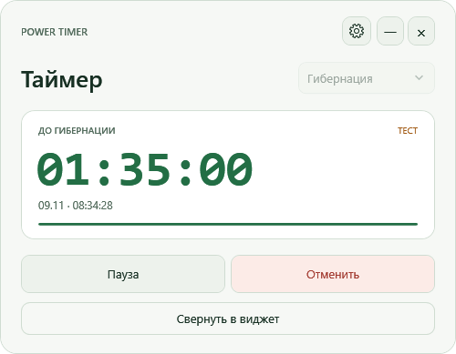

# Power Timer

Небольшой таймер выключения и гибернации для Windows с компактным виджетом, треем и локальным API для агентов. Бесплатный, без рекламы, телеметрии и внешних пакетов.

[Скачать готовую версию](https://github.com/romolego/PowerTimer/releases/latest) · [API и команды](API.txt) · [Проверки и устройство кода](DEVELOPMENT.md)

## Использование

Распакуйте `PowerTimer-portable.zip` и запустите `PowerTimer.exe`. Нужны Windows 10/11 и установленный .NET Framework 4.8. Права администратора обычно не требуются; системная политика может запрещать выключение пользователю.

- Выберите «Выключение» или «Гибернация» в верхней строке до запуска таймера. Постоянный выбор задаётся в настройках в поле «Действие по умолчанию».
- Семь настраиваемых интервалов. Первый выбран при запуске. В конце списка — «Своё время» в часах или минутах, например **3,5 часа**.
- В меню заголовка выберите «Ко времени» и укажите дату и время. В настройках можно оставить только время и выбрать начальное значение.
- Отдельная кнопка запуска, пауза, продолжение и отмена.
- Компактный виджет показывает отсчёт и стрелку. Двойной щелчок по отсчёту открывает главное окно, стрелка раскрывает кнопки управления.
- Тёмная, светлая и системная темы. Масштаб, непрозрачность и положение виджета.
- Автозапуск, сворачивание в трей и запрет автоматического сна во время отсчёта.
- Повторное открытие возвращает работающий экземпляр, сохраняя таймер.




## Работа таймера

Приложение должно оставаться запущенным, хотя бы в трее. Выход из приложения отменяет отсчёт. Обычный таймер измеряет длительность независимо от системных часов.

Режим «Ко времени» назначает одно действие в пределах ближайших семи суток. Если дата скрыта, под полем указано, сегодня или завтра наступит выбранное время. Виджет показывает срок и остаток. Пауза приостанавливает действие и сохраняет назначенный срок. Если срок прошёл, задайте новый.

После аварийного завершения будущий сохранённый таймер восстанавливается **на паузе**. Истёкший таймер снимается. Если срок прошёл во время сна или задержки обработки более 15 секунд, приложение снимает действие после возобновления.

По окончании отсчёта Power Timer передаёт Windows команду выключения `shutdown.exe /s /t 0 /d p:0:0` или гибернации `shutdown.exe /h`. Несохранённые документы могут остановить выключение. Power Timer отправляет запрос один раз. Его можно отменить до передачи Windows. Включение компьютера и пробуждение по расписанию не поддерживаются. [Поведение команды Windows](https://learn.microsoft.com/en-us/windows-server/administration/windows-commands/shutdown)

Гибернация доступна, если она включена в Windows. При включении компьютера Windows восстанавливает сохранённый сеанс. [Описание гибернации](https://support.microsoft.com/en-us/windows/experience/power-battery/shut-down-sleep-or-hibernate-your-pc)

Запрет сна снимается при паузе, отмене и выходе; он не препятствует ручному сну или разряду батареи. Экран может выключаться. [Описание системного механизма](https://learn.microsoft.com/en-us/windows/win32/api/winbase/nf-winbase-setthreadexecutionstate).

## Ресурсы и данные

В простое и на паузе нет периодического таймера приложения и фоновой записи настроек. При отсчёте обновление происходит примерно раз в секунду, последний вызов назначается на остаток до срока. Настройки и состояние записываются при изменениях через атомарную замену файла. Дополнительные окна создаются по запросу.

Данные хранятся в `%LOCALAPPDATA%\PowerTimer`. `api.json` содержит ключ текущего запуска: его нельзя публиковать. API слушает только `127.0.0.1`, требует ключ, отклоняет браузерные запросы с Origin и ограничивает размер, время и число соединений. Удалённый агент должен выполнять команды на этом Windows-компьютере.

```powershell
.\timerctl.exe status
.\timerctl.exe after 3.5h
.\timerctl.exe hibernate 30m
.\timerctl.exe pause
.\timerctl.exe resume
.\timerctl.exe cancel
```

Для удаления отключите автозапуск, выберите «Выход» в трее, удалите распакованную папку и при желании `%LOCALAPPDATA%\PowerTimer`. Приложение не подписано сертификатом издателя.

## Сборка и тесты

```powershell
powershell -NoProfile -ExecutionPolicy Bypass -File .\build.ps1
powershell -NoProfile -ExecutionPolicy Bypass -File .\run-tests.ps1 -SkipBuild
```

Сборка использует компилятор установленного .NET Framework. Python 3.11+ нужен только для интеграционных тестов. Тесты запускают отдельный `--test` экземпляр, где действия питания заменены записью в журнал. Системный автозапуск и запрет сна в нём не применяются. Автоматические проверки имитируют выключение и гибернацию.

Лицензия: [MIT](LICENSE.txt).
